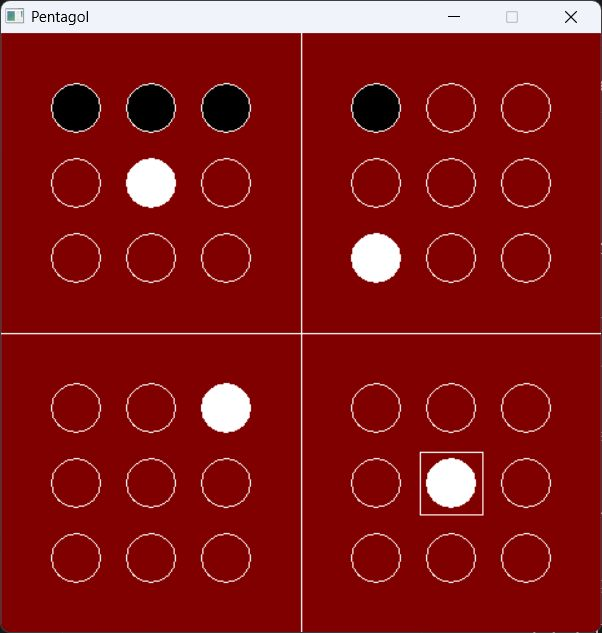

# Pentagol

Pentagol is a local two-player board game that grew out of a university C programming project. On each turn you place a marble, then rotate one quarter of the board. A single twist can move both players' pieces. The goal is a six-marble pattern with a bend at one end.



## How to play

Black moves first. The board has 36 spaces divided into four 3×3 quadrants.

1. Place a marble of your color in an empty space. If you complete a winning pattern, the game ends here.
2. Pick **any** quadrant and rotate it 90° clockwise (`+`) or counterclockwise (`-`). All nine spaces in that quadrant rotate together.
3. Check the board again. Either player can win after a rotation. If both players complete patterns at once, or all 36 spaces fill without a winner, the game is a draw.

The original C rules list the winning arrangements explicitly. Here is one example. Five black marbles run along the top row, and the sixth sits directly below the left end.

```text
b b b | b b .
b . . | . . .
. . . | . . .
------+------
. . . | . . .
. . . | . . .
. . . | . . .
```

### Controls

- **Graphical edition** — Click the board to focus it. Move the square cursor with lowercase `w`, `a`, `s`, `d` and press `f` to place your marble. Switch to the terminal, enter a direction and press Enter, then enter a quadrant number and press Enter. Return to the board for the next move.
- **Terminal edition** — Enter the row, column, direction, and quadrant when prompted. The row and column labels are `1 2 3 | 5 6 7`. The central divider occupies index 4 in the original board array.

Both editions use the same quadrant numbers.

```text
2 | 1
--+--
3 | 4
```

## Build and run

### Windows graphical edition

Open the shell included with 64-bit w64devkit, change to the repository directory, and run the commands below. The first configure downloads a pinned WinBGIm source archive and verifies its SHA-256 checksum. Keep the terminal open while playing. [w64devkit releases](https://github.com/skeeto/w64devkit/releases) · [WinBGIm dependency](https://github.com/ahmedshakill/WinBGIm-64/tree/2f8facbdeb4813e6a79394bfb9543f3a582f9d27)

```sh
cmake -S . -B build -G Ninja -DPENTAGOL_GRAPHICS=ON
cmake --build build
./build/pentagol.exe
```

This build also produces `build/pentagol-cli.exe`.

### Terminal edition

A C99 compiler is sufficient. From the repository root on Linux or macOS, run the following commands.

```sh
cc -std=c99 -O2 src/console.c src/rules.c -o pentagol-cli
./pentagol-cli
```

With CMake 3.20 or newer, you can also build the terminal edition offline.

```sh
cmake -S . -B build-cli -DPENTAGOL_GRAPHICS=OFF
cmake --build build-cli
```

Run `ctest --test-dir build-cli --output-on-failure` to replay a game in which White wins by rotating the upper-right quadrant.

## Inside the project

- [Game rules](src/rules.c) — The C routines that rotate a quadrant and recognize each player's winning arrangements.
- [Terminal game](src/console.c) — The turn loop and text board from the C edition.
- [Graphical game](src/graphical.cpp) and [board drawing](src/board.cpp) — The Windows edition uses WinBGIm from C++ and shares the C rules with the terminal edition.

Originally written by Hosein Ahmadzadeh in spring 2020. This edition keeps the original board artwork and winning-pattern list. The release fixes a duplicate console rotation and checks both colors, including multiple completed patterns, after each move.

## One game in five frames

1. [Opening board](docs/screenshots/01-opening.jpg) — The white square marks the cursor. Black starts at the upper-left space.
2. [First placement](docs/screenshots/02-before-rotation.jpg) — Black places the first marble under the cursor.
3. [After the twist](docs/screenshots/03-after-rotation.jpg) — Rotating quadrant 2 clockwise carries the marble two spaces right. The cursor stays at its original position.
4. [Midgame](docs/screenshots/04-midgame.jpg) — After eight turns, all four quadrants contain marbles.
5. [Winning move](docs/screenshots/05-winning-pattern.jpg) — On turn eleven, Black places the sixth marble under the left end of the top row and wins before rotating.
